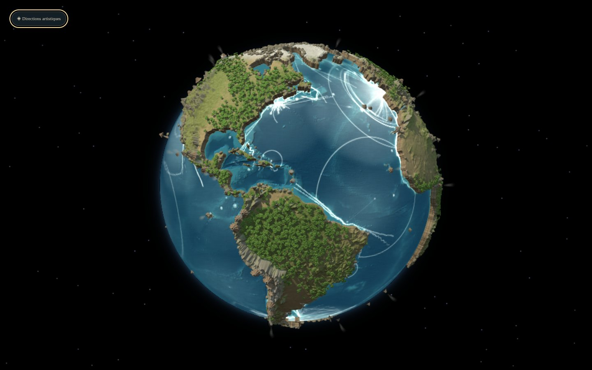

# Diorama : extension au globe entier

Branche `diorama-globe`, issue de `diorama-pilote` (Codex). Le pilote régional (Andes, Amazonie) est étendu à **toute la Terre**, à la demande de l'auteur, pour être testé sur le globe complet.



- **Terrain mondial** : grille de 0,25° (expo) ou 0,35° (léger), un sommet par nœud, couture de l'antiméridien soudée, triangles découpés au trait de côte comme dans le pilote. Expo : 392 000 sommets, 734 000 triangles de terrain, 395 000 triangles de falaises, construits en 2 à 3 s au premier affichage puis mis en cache (le zoom ne replace que la végétation).
- **Relief** : socle et massifs plus modérés que dans le pilote, et calottes glaciaires abaissées. Vus de loin, les massifs du pilote formaient des palissades au limbe. Tout cela est artistique ; le réglage « relief » du panneau `P` permet de les relever.
- **Couleurs** : limite des neiges selon la latitude (ordre de grandeur) et glaces polaires.
- **Végétation, rochers, volcans et fumées** : sur toute la Terre (semis régulier sur la sphère, environ 5 100 instances avec les modèles détaillés en expo).
- **Ombres** : elles couvrent toute la face visible, et le soleil reste fixe par rapport au regard pendant la rotation.

**Mesure sur la Radeon 780M** (Chromium sans fenêtre, Vulkan, 1440×900, profil expo, ombres 4096², MSAA 4×) : 5,3 à 6,2 ms par image en médiane, 90e centile entre 8,2 et 9,6 ms selon la face présentée. À confirmer en 1920×1200 plein écran.

Captures : [Amériques](captures/diorama-globe/ensemble-60.jpg) · [Afrique](captures/diorama-globe/ensemble20.jpg) · [Asie](captures/diorama-globe/ensemble100.jpg) · [Pacifique](captures/diorama-globe/ensemble-150.jpg) · détails [Afrique](captures/diorama-globe/detail-afrique.jpg), [Inde](captures/diorama-globe/detail-inde.jpg), [Caraïbes](captures/diorama-globe/detail-caraibes.jpg), [Indonésie](captures/diorama-globe/detail-indonesie.jpg).

Le diorama reste réservé au **mode globe** (écran). Sur la demi-sphère, il demanderait de rendre la scène 3D avec la caméra du projecteur : c'est possible si le test est concluant.

---

# Pilote : une miniature naturelle des Andes et de l'Amazonie

Branche `diorama-pilote`, issue de `directions-artistiques`. Le pilote couvre **88° O–48° O et 30° S–5° N**, avec raccord progressif au reste du globe. Il s'agit d'une exploration artistique régionale, pas d'une généralisation à toute la Terre.

## Visiter

Lancer `npm run dev`, puis ouvrir :

[Globe diorama, de jour](http://localhost:5173/?mode=globe&theme=day&style=diorama)

Le comparateur propose **Diorama pilote**. Les boutons **Ensemble**, **Vue rasante** et **Détail** cadrent la région ; le globe reste manipulable. **Masquer** permet d'apprécier la scène seule. `J` bascule jour/nuit et `P` ouvre les réglages, dont l'intensité du relief et l'enregistrement.

Changer de style conserve la caméra et le temps. L'ouverture directe du pilote initialise le cadrage d'ensemble. Les choix locaux et les cadrages ne sont plus effacés par le premier message de configuration du serveur.

Le pilote est réservé au **mode globe**. Carte, demi-sphère, fisheye et équirectangulaire conservent leur rendu et affichent une indication. Les modèles se chargent à la première sélection ; un échec conserve le rendu précédent et propose **Réessayer**.

## Ce qui change

- Terrain régional séparé de l'océan, fondé sur ETOPO : base continentale épaisse, massifs fortement exagérés, variations de crêtes et vallées. Les sommets atteignent environ **1,30 fois le rayon** de la planète au réglage par défaut : cette hauteur est entièrement artistique.
- Trait de côte découpé dans les triangles du terrain, avec des parois rocheuses et des bandes de matière. Les normales du sol sont raccordées ; relief et matériaux reviennent progressivement vers le rendu du reste du monde aux limites de la région.
- Matières mates de sol, sable, roche et sommets pâles, réparties selon altitude, pente et indice de forêt. Éclairage oblique, ambiance de ciel, ombres portées et matière fine. Les matériaux physiques reçoivent leur conversion d'affichage avant la finition commune.
- **Dix modèles Blender originaux**, chacun en version normale et légère : deux arbres tropicaux, deux arbres à silhouette étagée, deux buissons, deux volcans et deux rochers. Troncs ramifiés, houppiers organiques réunis, petites feuilles pliées, cratères réellement creusés et flancs irréguliers.
- Forêts placées par bosquets, avec éclaircies et évitement des pentes fortes. Volcans espacés selon le zoom pour limiter les recouvrements ; leurs positions conservées viennent du GVP. Fumée souple par particules transparentes, selon le seuil d'année artistique existant.
- Les ondes, navires, espaces de communication et liens restent dans la texture océanique émissive. Les nouvelles ombres terrestres ne s'y appliquent pas. Aucun paramètre ni grille du modèle acoustique n'est remplacé.

## Comparaison et rotation

| Cadrage | Avant : monde sculpté | Pilote jour | Pilote nuit |
|---|---|---|---|
| Ensemble | [Avant](captures/diorama/avant-overview.png) | [Jour](captures/diorama/day-overview.png) | [Nuit](captures/diorama/night-overview.png) |
| Vue rasante | [Avant](captures/diorama/avant-grazing.png) | [Jour](captures/diorama/day-grazing.png) | [Nuit](captures/diorama/night-grazing.png) |
| Détail | [Avant](captures/diorama/avant-detail.png) | [Jour](captures/diorama/day-detail.png) | [Nuit](captures/diorama/night-detail.png) |

[Rotation du pilote — MP4, 3 secondes](captures/diorama/rotation.mp4) · [Modèles dans Blender](captures/diorama/modeles-blender.png) · [Détail avec le profil expo](captures/diorama/expo-detail.png) · [Comparateur](captures/diorama/comparateur.png)

## Sources et reconstruction

Les données géographiques restent celles du projet : altitude ETOPO, côte Natural Earth et indice de vert artistique issu de NE II ; positions et années d'éruption du Smithsonian GVP. La sélection visuelle de volcans n'est pas un inventaire exhaustif à chaque niveau de zoom. La fumée n'est pas un état d'activité en direct. Tous les volumes, tailles, détails sculptés, couleurs et densités sont artistiques.

Les modèles sont créés pour ce projet, sans téléchargement d'assets ni textures externes. Sources : `tools/diorama/modeles.blend` et `tools/diorama/build_assets.py`. Reconstruction avec Blender 5.2 ou une version compatible :

```bash
ALSOFT_DRIVERS=null blender -b -noaudio --python tools/diorama/build_assets.py
```

Le script réexporte les vingt GLB dans `client/public/models/diorama/`, le fichier Blender et la planche de contrôle. Les versions `-light` réduisent la géométrie. Tous les modèles réunis représentent moins de 1 Mo ; ils sont servis aussi dans la compilation de production.

## Vérification

- **87 tests réussis**, typage TypeScript et compilation Vite réussis. Avertissement préexistant sur les imports statique/dynamique de `geo-grids.ts`.
- Tests du raccord régional, de l'exagération des massifs, des normales, des sommets soudés, de l'absence de terre dans une zone marine et de la restriction au globe.
- Chromium/Brave avec WebGL2 via **SwiftShader**, fenêtre 1120×840 : captures jour/nuit, comparaison au style précédent, géographie sous le curseur, conservation du temps et du cadrage, sauvegarde/relecture.
- Dans le profil `light` contrôlé : **43 476 sommets de terrain**, **26 136 sommets de falaises**, **637 instances** ; rayon maximal **1,298**. Nombre de géométries stable après changements de style : **33 → 33**.
- Profil `expo` également contrôlé dans Chromium : modèles détaillés chargés, **96 423 sommets** de terrain et ombres **4096²**, sans erreur de shader.
- Échec de chargement simulé : message de reprise visible, scène précédente conservée, chargement réussi après clic sur **Réessayer**. Aucune erreur JavaScript/GLSL pendant la vérification normale.

Reproduire les captures, la vidéo et les contrôles (Playwright Core disponible séparément, serveur de développement actif, FFmpeg installé) :

```bash
PLAYWRIGHT_MODULE=/chemin/vers/playwright-core/index.mjs \
CHROMIUM_PATH=/chemin/vers/chromium \
node scripts/verify-diorama.mjs
```

Le script teste brièvement la sauvegarde et restaure ensuite le fichier local initial ; éviter une édition simultanée de la configuration.

**Les 60 images/s sur Radeon 780M ne sont pas validées par ces images logicielles.** Le profil `light` utilise une maille régionale de 0,15°, les modèles simplifiés, moins de végétation et des ombres 2048². `expo` utilise 0,1°, les modèles détaillés, des ombres 4096² et MSAA 4×. La densité, la qualité artistique et les performances de ce pilote doivent être appréciées avant toute extension mondiale.
