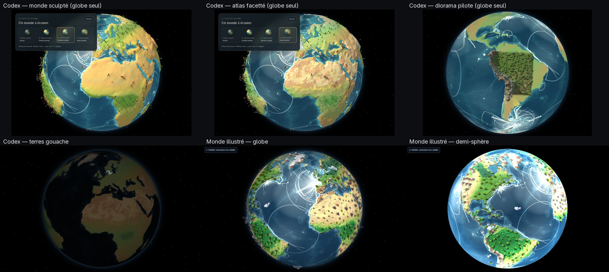

# Le monde illustré (`land.style: 'illustre'`)

Branche **`monde-illustre`**, partie de `main` (commit `490cc3d`). Reprise du chantier « terres gouache » de Codex :
les terres et les ornements sont refaits pour être **visibles sur la demi-sphère d'exposition**, avec un
langage d'illustration hors d'échelle (montagnes, volcans, bosquets, nuages), à la manière des livres et
globes illustrés pris pour référence.



## Ce qui a changé par rapport au travail de Codex

| | Codex | Monde illustré |
|---|---|---|
| Terres | Couleurs NE II stylisées dans le shader (bruit de pinceau calculé à chaque image) | Milieux illustrés, paliers de relief, ombres portées, plages : **précalculés** en Python, le shader ne fait que lire |
| Relief 3D | Maillages sculptés / facettés, diorama régional | Aucun maillage : le volume vient de la lumière précalculée et des paliers |
| Ornements | Arbres dessinés par le shader (carte zoomée seulement) ; volcans en points | **Imposteurs** rendus dans Blender, dessinés dans **tous les modes**, demi-sphère comprise |
| Demi-sphère | Ni ornements ni volumes (la projection ne lit que la texture monde) | Terres peintes dans la texture monde, ornements projetés avec la caméra du projecteur |

Pourquoi pas de 3D sur la demi-sphère : la demi-sphère reçoit l'image d'un projecteur placé dans son axe ; vu
de là, un relief en volume se confond presque entièrement avec la surface (on le voit « de dessus »). Ce qui
donne l'impression de volume, ce sont les ombres et la lumière : elles sont donc précalculées et peintes
dans les terres. Les vignettes (montagnes, volcans, arbres) apportent la silhouette.

Les propositions 3D de Codex restent **archivées** sur leurs branches (`directions-artistiques`, `diorama-pilote`),
sans être fusionnées : aucune maintenance. Pour les revoir en direct, voir « Comparer » plus bas.

## Les terres

Cartes précalculées par `tools/build_illustrated.py` (≈ 1 minute) :

- `data/grid/land_biome_4096.png` : neuf milieux (glace, toundra, forêts boréale / tempérée / tropicale,
  prairie, savane, désert de sable, désert de roche) tirés des couleurs Natural Earth II, frontières
  « peintes » (vote majoritaire flou, bords déformés), nuances internes, densité de forêt ;
- `data/grid/land_shape_4096.png` : distance signée à la côte (±2°), altitude lissée pour les paliers,
  lumière d'une maquette (ombré, ombres portées vers le sud-est, vallées assombries).

Le shader (`client/src/render/flat-view.ts`, `illustratedLand` / `illustratedSea`) mélange les couleurs de la
palette du thème (nuit ou jour), ajoute neiges et roche d'altitude, paliers « en couches de papier », plage,
liseré des côtes éclairées, plateau continental, ombre des terres sur la mer et quelques lignes d'eau fixes.
Les largeurs (plage, ombres, lignes) sont exprimées **en pixels d'écran** : elles restent lisibles sur la
demi-sphère comme sur la carte zoomée.

## Les ornements

- **Vignettes** : `data/ornaments/atlas.png` (43 vignettes, 2048×2048). Bosquets tropicaux, tempérés, boréaux,
  savane, prairie, désert, toundra : modèles du pack *Ultimate Stylized Nature* de **Quaternius (CC0)**,
  composés et teintés par milieu. Montagnes enneigées, montagnes, plateaux de grès, volcans (cratère
  incandescent), fumées et nuages : **modélisés de façon procédurale** dans `tools/ornaments/render_cells.py`.
  Rendu Cycles en vue de trois quarts, lumière venant du nord-ouest (comme les terres), ombre portée incluse.
- **Placements** : `data/grid/ornaments.json`, 20 756 positions en quatre niveaux de détail emboîtés
  (bruit bleu sur la sphère, espacements 3,6° → 0,45°). Volcans aux positions du **Smithsonian GVP**, montagnes
  sur les sommets du relief **ETOPO**, végétation selon les milieux.
- **Dessin** (`client/src/render/ornaments.ts`) : une seule passe de quadrilatères instanciés, après la
  composition, avec la projection exacte de chaque mode (carte, globe, demi-sphère, équirectangulaire,
  fisheye). Au centre du disque, les vignettes sont droites ; près du bord, elles s'inclinent le long du rayon
  puis s'effacent. Sur la demi-sphère, rien n'est dessiné hors du disque et la même compensation de
  luminosité que la projection est appliquée. Un niveau de détail apparaît quand son espacement à l'écran
  dépasse la taille des vignettes, chaque vignette avec un seuil légèrement différent : en zoomant, la forêt
  « pousse » progressivement.
- **Animations** : fumée des volcans dont la dernière éruption est postérieure à `smokeSinceYear` (2010 par
  défaut) ; nuages qui dérivent vers l'est, avec leur ombre au sol. La nuit, les vignettes prennent la teinte
  `ornament` de la palette ; les cratères gardent leur lueur.

## Traçabilité

| Élément | Statut |
|---|---|
| Altitude, trait de côte, profondeur du plateau continental (ETOPO 2022, Natural Earth) | **sourcé** |
| Positions et années d'éruption des volcans (Smithsonian GVP) | **sourcé** |
| Sommets portant une montagne (maxima locaux d'ETOPO lissé) | **sourcé** (position), **artistique** (sélection) |
| Milieux illustrés : interprétation des couleurs NE II, seuils, latitudes des forêts | **artistique** |
| Limite des neiges (≈ 5 500 m sous les tropiques, niveau de la mer vers 72°) | **ordre de grandeur** |
| Exagération du relief, direction et hauteur du soleil, paliers, plages, ombres, lignes d'eau | **artistique** |
| Tailles, densités, compositions des bosquets, fumées, nuages, palettes | **artistique** |

La fumée n'est pas un état d'activité en direct ; les nuages n'ont aucun lien avec la météo ; une forêt
dessinée n'est pas une mesure de couverture forestière. Les montagnes et volcans sont volontairement hors
d'échelle.

## Régler

Panneau `P` → **Terres** : style (monde illustré / gouache / aplat), dossier **Monde illustré** (relief,
paliers, neiges, côtes, plateau, lignes d'eau, couleurs du thème affiché) et **Ornements** (taille,
croissance au zoom, densité, végétation, montagnes, volcans, fumée, nuages). `J` bascule nuit / jour (le
panneau affiche alors la palette correspondante). « Enregistrer » écrit `config/local.json5`.

`land.style: 'gouache'` restitue la proposition de Codex, `'flat'` le rendu d'origine.

## Performances (Radeon 780M, mesurées)

`scripts/verify-illustrated.mjs` lance Chromium sans fenêtre, qui utilise la **vraie Radeon 780M** (Vulkan,
RADV). En 1920×1200, cible projecteur, sans limite à 60 images/s et en vidant le GPU à chaque image :

| Profil | Mode | Aplat | Gouache | Monde illustré + ornements |
|---|---|---|---|---|
| expo | demi-sphère | 7,4 ms | 6,4 ms | 5,9 ms (90e centile 9,1 ms) |
| expo | globe | 5,4 ms | 5,7 ms | 5,7 ms (90e centile 8,8 ms) |
| expo | carte | 5,8 ms | 5,8 ms | 5,3 ms (90e centile 8,0 ms) |
| light | demi-sphère | 5,9 ms | 6,2 ms | 6,5 ms (90e centile 9,6 ms) |

Les écarts entre styles sont dans le bruit de mesure : le monde illustré ne coûte rien de mesurable, et tout
reste sous les 16,7 ms d'une image à 60 Hz. À confirmer en plein écran sur le projecteur (compositeur du
bureau), avec `D`.

## Reconstruire

```bash
python3 tools/build_illustrated.py            # cartes des terres et placements (numpy, pillow, scipy)
# Vignettes : dossier « Blends » du pack Quaternius (CC0), décompressé hors du dépôt
blender -b --factory-startup -noaudio --python tools/ornaments/render_cells.py -- <Blends> <dossier temporaire>
python3 tools/ornaments/pack_atlas.py <dossier temporaire>
```

Le rendu complet des vignettes prend une dizaine de minutes sur le processeur. On peut ne refaire qu'une
partie : `render_cells.py -- <Blends> <dossier> volcano,mesa` (catégories séparées par des virgules), puis
`pack_atlas.py`. Le pack n'est pas versionné (400 Mo) ; seul l'atlas produit l'est.

## Vérifier, comparer

```bash
npm test                     # dont l'aller-retour géographie → écran → géographie des vignettes, dans chaque mode
PLAYWRIGHT_MODULE=… CHROMIUM_PATH=… VACARME_URL=http://localhost:5173/ node scripts/verify-illustrated.mjs
```

Captures : [demi-sphère nuit](captures/monde-illustre/hemisphere-nuit.jpg) ·
[demi-sphère jour](captures/monde-illustre/hemisphere-jour.jpg) · [globe](captures/monde-illustre/globe-jour.jpg) ·
[globe nuit](captures/monde-illustre/globe-nuit.jpg) · [Asie](captures/monde-illustre/globe-asie.jpg) ·
[fisheye](captures/monde-illustre/fisheye-jour.jpg) · [équirectangulaire](captures/monde-illustre/equirect-nuit.jpg) ·
[carte nuit](captures/monde-illustre/carte-nuit.jpg) · [carte jour](captures/monde-illustre/carte-jour.jpg) ·
[Andes](captures/monde-illustre/andes.jpg) · [Alpes](captures/monde-illustre/alpes.jpg) ·
[Himalaya](captures/monde-illustre/himalaya.jpg) · [Amazonie](captures/monde-illustre/amazonie.jpg) ·
[Indonésie de nuit](captures/monde-illustre/indonesie-nuit.jpg) · [Sahara](captures/monde-illustre/sahara.jpg) ·
témoins [gouache](captures/monde-illustre/gouache-comparaison.jpg) et [aplat](captures/monde-illustre/aplat-comparaison.jpg).

Revoir en direct une proposition 3D de Codex, à côté (autre port, sans toucher à `main`) :

```bash
git worktree add ../vacarme-diorama diorama-pilote
cd ../vacarme-diorama && npm ci
PORT=8790 npm run start -w server &
cd client && VACARME_PORT=8790 npx vite --port 5177
```

## Reste à faire sur place

- Juger la palette de nuit et la teinte des vignettes sur l'Epson EB-990U et la demi-sphère réelle (noirs gris).
- Ajuster `ornaments.size` à la taille physique du dôme et à la distance du public.
- Si l'on souhaite une matière plus « peinte à la main » : remplacer des vignettes de l'atlas par des
  gouaches scannées (même grille, même point d'ancrage) ; aucun code à changer.
