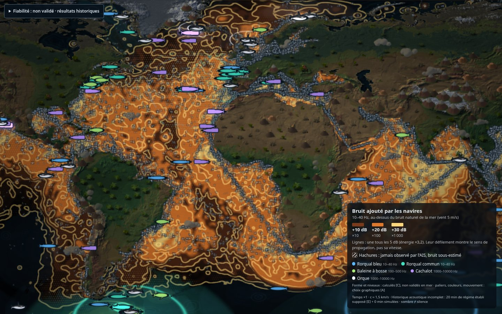
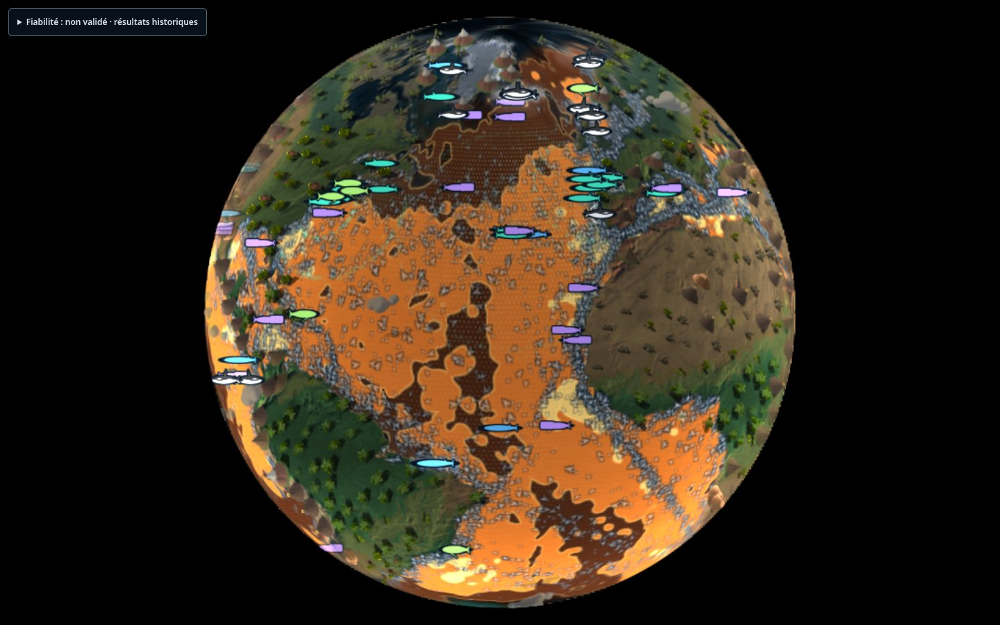
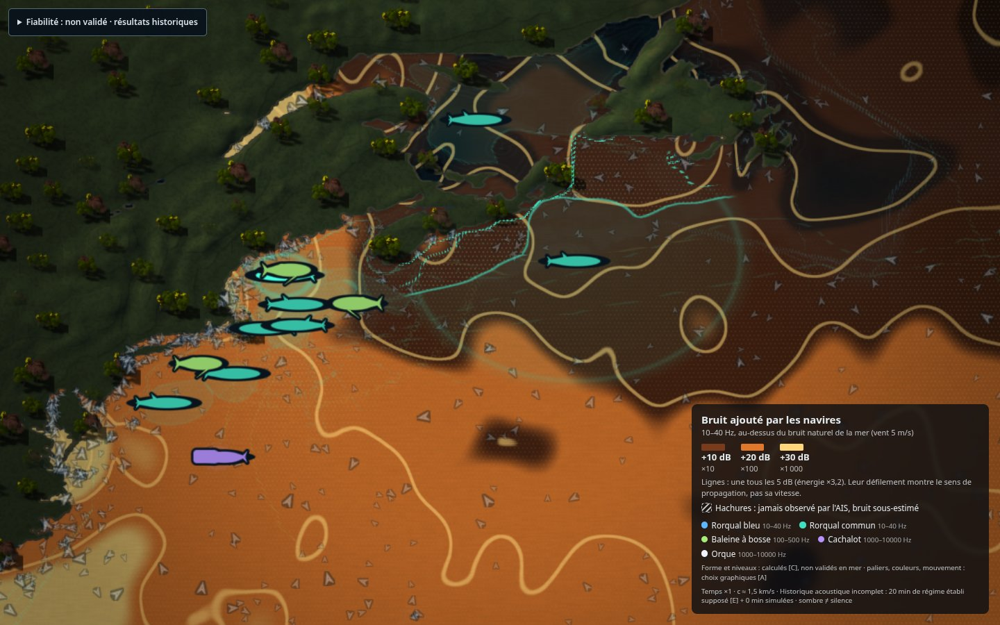

# Représentation du bruit, des cétacés et des navires

Refonte d'octobre 2026 (branche `refonte/lisibilite`). Constat de départ : la science était documentée et
honnête, mais l'image ne se lisait plus. Carte presque noire au démarrage, trois blancs pâles additionnés
(fronts, navires, cétacés), aucune légende, fronts immobiles à ×1, espèces indiscernables.

Principe : **la forme vient du modèle, le langage graphique est un choix**. Chaque nouvelle valeur ci-dessous
porte son statut : [C] calculé par le modèle, [E] choix empirique, [A] choix artistique, [S] sourcé.
Aucune de ces conventions ne change les niveaux calculés (`docs/PROPAGATION.md`, `docs/MODELE_PHYSIQUE.md`).



## Trois couches séparées

| Couche | Contenu | Couleurs |
|---|---|---|
| Monde | terres illustrées, mer, ornements (`docs/MONDE_ILLUSTRE.md`) | `land.illustrated.*` |
| Données | bruit ajouté, cétacés, navires | chaud = bruit (`palette.noise*`) ; froid = vivant (`whales.species[].color`) ; navires gris à liseré sombre |
| Textes | légende permanente, Fiabilité, diagnostic | HTML |

Le style du monde peut changer (nouvelles textures, nouvel atlas) sans toucher à la lecture des données.

## Bruit ajouté par les navires

**Grandeur affichée** [C] : ΔL = 10·log10(1 + E_navires / E_naturel), dans **une seule bande** (`waves.band`,
10–40 Hz par défaut), nommée dans la légende. Ce n'est pas un seuil biologique. C'est l'apport collectif de
tous les navires au fond naturel modélisé (vent 5 m/s [E]).

**Préparation d'affichage** :
- lissage temporel de l'énergie sur `noise.smoothSec` = 45 s de scène [E]. Il supprime le pompage de la
  moyenne courte du modèle (6 s, face à une porteuse numérique de 156 s ; voir #8) ;
- lissage spatial gaussien σ = 2 cellules, environ 80 km, en mer seulement [E]. Il retire le grain
  d'interférence de la porteuse (6 cellules) et reste sous la résolution réelle de l'information (grille
  de 39 km, positions extrapolées) ;
- préchauffage `noise.warmupMinutes` = 20 min de scène [E] : un **régime établi supposé**, navires
  immobiles, calculé au début de chaque histoire. En 20 min, un navire parcourt moins d'une cellule. La
  légende l'annonce (« 20 min de régime établi supposé »). Sans lui, la carte est noire pendant des
  minutes : c'est le temps de parcours à 1,5 km/s.

**Paliers** [A] : +10 / +20 / +30 dB, soit ×10 / ×100 / ×1000 l'énergie du fond naturel. Avec le trafic
estimé mondial, la médiane de ΔL est de +11 dB [C] en 10–40 Hz, le 90e centile de +27 dB et le 99e de
+37 dB [C] (mesure du 25 oct. 2026, 50 854 navires estimés) : les trois paliers se répartissent sur la
carte. Un voile léger signale l'apport entre +1 et +10 dB.

**Styles interchangeables** (touche `V`, panneau `P` → *Bruit ajouté*, barre d'outils du web) :

| Style | Ce qu'on voit | Statut du mouvement |
|---|---|---|
| `isophones` (défaut) | nappe en paliers et lignes d'égal niveau tous les 5 dB (énergie ×3,2) | les lignes défilent vers les niveaux faibles, donc vers l'extérieur, à 0,35 ligne/s **réelle** [A]. Elles indiquent le **sens** de propagation, pas sa vitesse |
| `meteo` | même nappe, immobile, un trait fin à chaque palier | aucun |
| `encre` | nappe atténuée, traînées d'encre nées dans les zones bruyantes qui descendent la pente de ΔL | naissance ∝ bruit, 2,5°/s, vie de 9 s, estompage 1,2 s [A], temps réel |
| `fronts` | fronts bruts du modèle et lueur d'accumulation (rendu d'avant la refonte) | modèle : c ≈ 1,5 km/s ; espacement numérique de 234 km sans sens acoustique |

Toutes les représentations lisent la même grandeur : leur surcoût est surtout leur légende. `fronts` reste
contrôlé par `npm run test:propagation`, sans changement.



**Terra incognita** : hachures obliques ancrées dans la géographie, comme les blancs des cartes anciennes,
sur la nappe atténuée. Le bruit y est sous-estimé : l'AIS n'y voit pas les navires.

## Cétacés : deux niveaux de détail

**Vue globale** :
- une silhouette de profil par espèce, à taille fixe à l'écran (26 px [A], hors d'échelle comme les
  ornements), en couleur froide propre et avec un liseré sombre ;
- formes simplifiées des espèces : rorqual bleu long et fin, rorqual commun à dorsale plus haute,
  baleine à bosse à longues pectorales, cachalot à tête carrée, orque bicolore à haute dorsale ;
- à chaque appel, la silhouette s'éclaire avec un halo ;
- fils de 2,2 px colorés par espèce (impulsions, effilochage, fantôme : `shared/src/whales/links.ts`).
  L'espace de communication n'y est qu'un voile léger.

**Vue rapprochée**, au-delà de 14 à 30 px par degré, pour le **groupe focal**, le plus proche du centre de
la vue. Les zones sont calculées pixel par pixel avec l'équation du sonar [C], sur le même champ lissé que la
nappe :
- **zone pleine** : encore audible malgré les navires (SE > 0 avec bruit actuel) ;
- **pointillés** : portée sans navires (SE > 0 avec le seul fond naturel) ;
- **semis de points** : espace perdu, audible sans navires mais plus maintenant ;
- **anneau d'appel** : il part du groupe à chaque appel, atteint la portée sans navires en 3,2 s de scène
  [A], reste vif dans la zone audible et se brise en éclats dans l'espace perdu. Il est masqué au-delà de
  ×10, où il clignoterait.

`visualScale` (exagération des distances, `docs/REVUE_SCIENTIFIQUE.md` §6) est inchangé.



## Ce que représentent les cétacés

Un groupe affiché n'est pas un animal suivi. C'est **une vraie espèce, placée dans un habitat où elle
est connue, près d'endroits où elle a été vue**. Trois couches y contribuent
(`tools/build_habitats.py`, `client/src/whales/agents.ts`, `config/default.json5`,
`docs/REVUE_SCIENTIFIQUE.md` §6.7) :

| Couche | Nature | Limites |
|---|---|---|
| **AquaMaps** (`data/habitats/<espèce>.png`) [S] | modèle d'**adéquation de l'habitat** (Kaschner et al.), note de 0 à 1 par case de 0,5°, version « native range » | ni densité, ni effectif, ni probabilité de rencontre ; **moyenne annuelle, sans saison** |
| **OBIS** (`data/habitats/sightings.json`) [S] | observations réelles depuis 2015 (245 jeux de données), un point par case de 0,25°, 400 points tirés par espèce | seules la latitude et la longitude sont gardées ; fort **biais d'effort** : un point signale surtout qu'il y avait un observateur |
| **Groupes affichés** (`WhaleAgents`) [A] | 30 à 40 groupes par espèce ; 70 % partent près d'une observation OBIS, 30 % sont tirés selon AquaMaps ; marche aléatoire accélérée ×30 | pas d'effectif, pas de taille de groupe, pas de migration, pas de saison : des présences **plausibles** |

Champs OBIS disponibles mais pas encore récupérés (échantillon de 200 baleines à bosse depuis 2015,
issue #15) :

| Champ | Remplissage | Utilité |
|---|---|---|
| `eventDate` / `month` | ≈ 91 % | saisonnalité, mais mêlée à l'effort d'observation |
| `basisOfRecord` | 100 % (185 `HumanObservation`, 15 `MachineObservation`) | distinguer une vue directe d'une balise ou d'une détection acoustique |
| `individualCount` | 168 sur 200 valent 1 | **inutilisable pour la taille des groupes** : souvent un enregistrement par individu |
| `sex` | ≈ 20 % | anecdotique |
| `lifeStage`, `behavior` | ≈ 0 % | rien |
| `bathymetry`, `sst`, `shoredistance` | ≈ 100 % | contrôle des profondeurs minimales par espèce |

OBIS ne distingue pas les écotypes d'orques, dont les répertoires vocaux diffèrent.

**Formulations pour le public** :
- ✅ « une vraie espèce, dans un habitat où on la sait présente, près d'endroits où elle a été vue » ;
- ❌ « une baleine est ici maintenant » ;
- ❌ « les zones sans observations sont vides » : elles sont surtout peu observées.

## Navires

- **Chevrons** orientés selon la route fond [S, AIS], de 7 px [A], avec un liseré sombre.
- **Navires estimés** (GFW) en chevrons creux et plus discrets. Un navire arrêté est un point.
- Mélange normal (et non additif) : les couloirs ne saturent plus en blanc.

## Temps décoratif

Tout ce qui est décoratif suit l'**horloge murale** : défilement, brouillard, grain, scintillement des
contours, tremblement des fils, rotation du globe. À ×100, l'image reste calme. Navires, cétacés, appels
et champ acoustique suivent l'horloge de la scène.

## Légende

Elle est toujours visible, en bas à droite, et plus grande en cible projecteur. Elle donne :
- la bande ;
- les paliers avec leur facteur d'énergie ;
- la phrase propre au style ;
- les hachures ;
- les espèces avec leur bande ;
- le statut [C]/[A] ;
- l'état de l'histoire acoustique.

Elle est masquée en demi-sphère, équirect et fisheye : ses coins tomberaient hors du dôme. Elle est
repliée sur les petits écrans. L'information n'est jamais portée par la couleur seule : paliers, lignes,
formes et motifs (hachures, pointillés, points).

## Performances (Radeon 780M, 1920×1200, 50 854 navires estimés, cadence normale 60 Hz)

`scripts/verify-representation.mjs`, 25 oct. 2026, avec le serveur de développement actif sur la même
machine :

| Mode | Médiane | p99 | Images > 34 ms sur 6 s |
|---|---|---|---|
| demi-sphère, tous styles | 16,4–16,6 ms | 36–45 ms | 4–7 |
| globe, tous styles | 16,4–16,6 ms | 33–41 ms | 3–6 |
| carte plate, tous styles | 16,6–16,7 ms | 24–32 ms | 0–1 |

Référence avant la refonte (`dc7e3f5`, demi-sphère, 15 s) : médiane 16,6 ms, p99 30 ms, 6 images > 34 ms.
Le coût visible vient de la relecture du champ pour les cétacés et le son, une fois par pas du modèle.
Elle relit désormais des octets empaquetés (16 bits, écart ≤ 0,002 dB) au lieu de flottants 32 bits.
Mesurer sans limite de cadence fausse ces chiffres : le processeur empile des images d'avance, et toute
relecture attend alors la file GPU (jusqu'à 2 s).

## Vérifier

```sh
npm run dev
CHROMIUM_PATH=/chemin/chrome node scripts/verify-representation.mjs   # captures + temps d'image
npm run test:propagation                                              # fronts bruts, inchangés
CHROMIUM_PATH=/chemin/chrome node scripts/verify-audio.mjs           # sons des cétacés : chargement, sortie enregistrée, temps d'image
```

Les captures de référence sont dans `docs/captures/representation/`.
