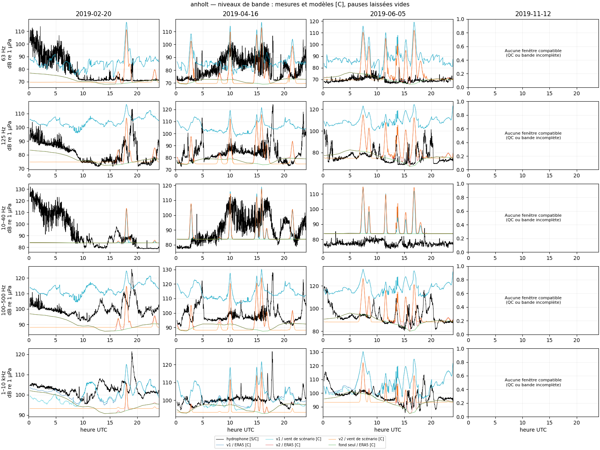
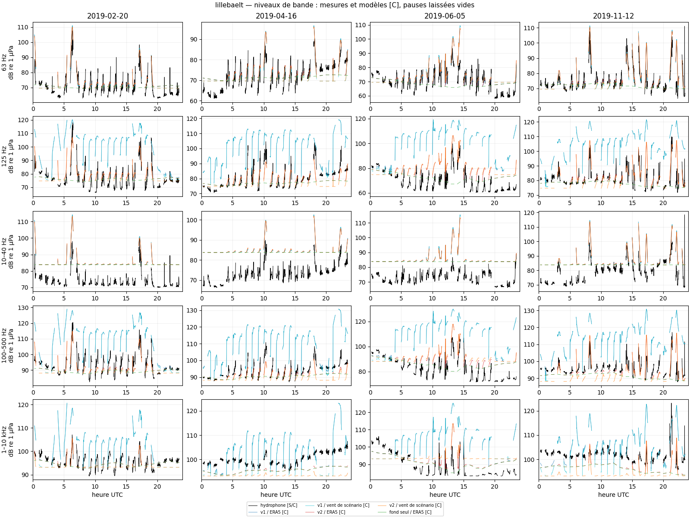
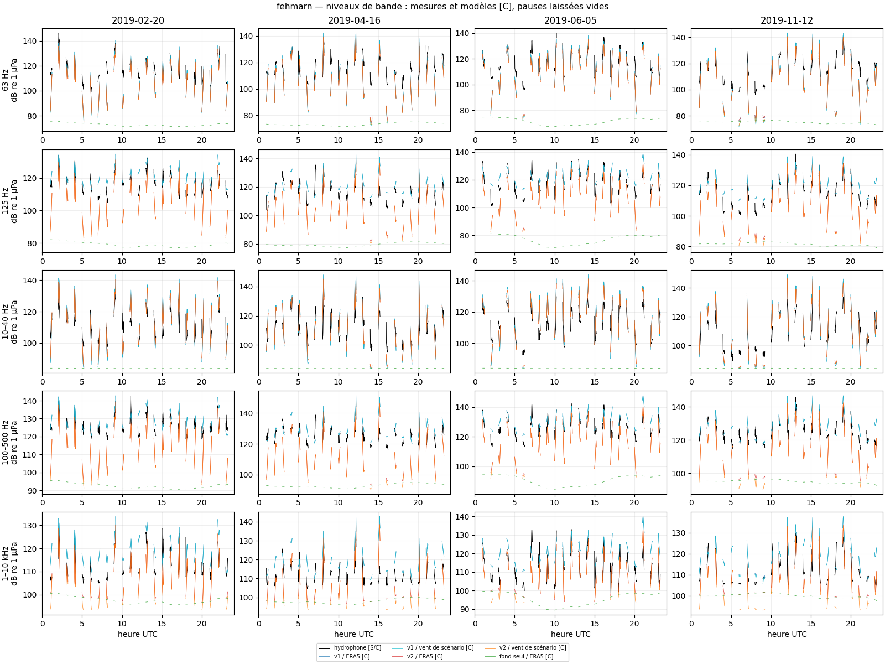
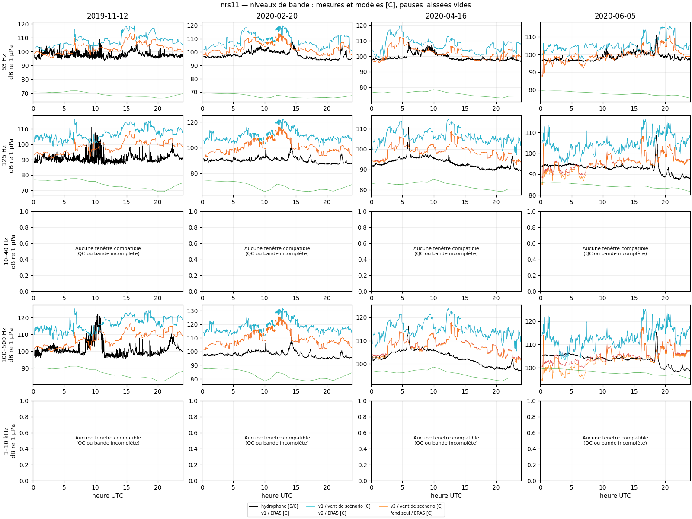
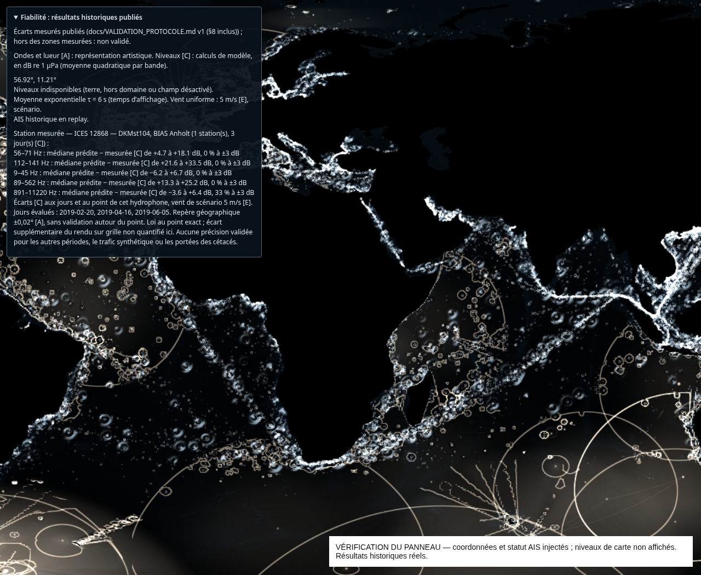
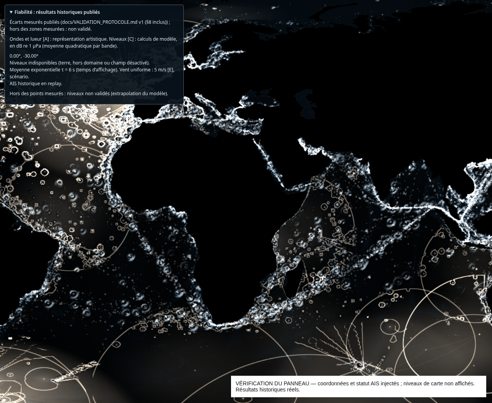

# Confrontation des niveaux sonores aux hydrophones

Résultats du protocole pré-enregistré [v1](VALIDATION_PROTOCOLE.md), avec ses écarts datés au §8. Les stations de test ont été calculées dans une seule exécution, après le calage. Aucun réglage ne suit ces résultats.

**Statuts des nombres** : données et métadonnées des producteurs [S] ; métriques, effectifs et niveaux dérivés [C] ; paramètres optimisés [C-calé] ; paramètres empiriques fixes [E] ; repères d’interaction dans l’app [A]. Dans les tableaux de résultats, toutes les cellules numériques sont [C]. Les dates identifient les jours de mesure.

## Résultat principal sur les stations de test

ΔL50 = médiane prédite − médiane mesurée ; ΔL10 = percentile 90 prédit − percentile 90 mesuré. Un écart positif signifie une surestimation. Le dénominateur est le nombre de comparaisons station × jour × bande compatibles après QC, sans pondération par leur nombre de minutes. Les bandes principales sont 125 Hz, 100–500 Hz et 1–10 kHz [C, définition du protocole].

| Régime | Variante | Médianes à ±3 dB [C] | Fraction [C] | Critère ≥80 % [E, pré-enregistré] |
|---|---|---:|---:|---|
| Eau peu profonde | v1 / ERA5 | 4/33 | 12.1 % | non atteint |
| Eau peu profonde | v1 / vent de scénario | 3/33 | 9.1 % | non atteint |
| Eau peu profonde | v2 / ERA5 | 9/33 | 27.3 % | non atteint |
| Eau peu profonde | v2 / vent de scénario | 5/33 | 15.2 % | non atteint |
| Eau peu profonde | fond seul / ERA5 | 9/33 | 27.3 % | non atteint |
| Eau profonde, un point | v1 / ERA5 | 0/8 | 0.0 % | non atteint |
| Eau profonde, un point | v1 / vent de scénario | 0/8 | 0.0 % | non atteint |
| Eau profonde, un point | v2 / ERA5 | 2/8 | 25.0 % | non atteint |
| Eau profonde, un point | v2 / vent de scénario | 2/8 | 25.0 % | non atteint |
| Eau profonde, un point | fond seul / ERA5 | 0/8 | 0.0 % | non atteint |

**Eau peu profonde : critère non atteint** pour la variante affichée : 3/33 médianes à ±3 dB [C]. La formulation « compatible avec les mesures à l’état de l’art des cartes publiées » n’est pas autorisée par le protocole.

**NRS11, un seul point profond : critère non atteint** pour la variante affichée : 0/8 médianes à ±3 dB [C]. La formulation « compatible avec les mesures à l’état de l’art des cartes publiées » n’est pas autorisée par le protocole.

**Profil actuellement affiché : `north-sea-reference-v1`**, variante `world-law-wind5` (vent uniforme de scénario 5 m/s [E]). Décision de l’auteur du 15/10/2026 : conserver v1 et garder v2 comme étude hors ligne. Un résultat ERA5 ne décrit pas à lui seul le scénario de l’exposition.

Repère publié [S, lu dans le travail antérieur] : Farcas et al. (2020), *Validated shipping noise maps of the Northeast Atlantic*, STOTEN 735, 139509, DOI [10.1016/j.scitotenv.2020.139509](https://doi.org/10.1016/j.scitotenv.2020.139509) : 93 % des médianes à ±3 dB, tiers d’octave 125 Hz–5 kHz. Notre choix de bandes, notre échantillonnage et les conditions diffèrent : ce repère ne constitue pas une comparaison statistique à échantillon identique.

## Mesures, qualité et couverture

Le [dossier QC](validation/qc/REVUE.md) publie les figures, les sélections de segments et les exclusions décidées sur les seules mesures. Critères appliqués par l’agent : **pas une revue d’acousticien**. L’étalonnage est déclaré par les producteurs [S], sans réétalonnage indépendant.

Information manquante [S, métadonnées ICES] : date d’étalonnage absente pour Anholt en hiver, printemps et été, Horns Rev 3 en automne et Stevns au printemps et en été. La procédure CPC est déclarée dans ces fichiers ; le critère pré-enregistré portait sur cette déclaration, sans exiger la date. Aucun retrait n’a été ajouté après le test. Les [métadonnées des extractions](validation/measurement-metadata/) sont conservées : déclarations du producteur [S], comptages d’export [C].

Stevns en hiver et Anholt en automne sont exclus pour silence instrumental persistant (écart n° 3 approuvé) ; Hjelm en été comporte deux silences exclus, total 47 min [C]. Les bandes ≤63 Hz [C, définition du protocole] restent évaluées avec signalement d’écoulement, hors objectif du calage. Les chœurs possibles à NRS11 restent conservés. À NRS11, 10–40 Hz et 1–10 kHz ne sont pas reconstituables complètement : aucun chiffre n’est inventé pour ces bandes.

| Station de test | Jours prévus [C] | Jours avec résultat [C] | Fenêtres appariées, variante active [C] |
|---|---:|---:|---:|
| anholt | 4 | 3 | 4272 |
| lillebaelt | 4 | 4 | 2818 |
| fehmarn | 4 | 4 | 1378 |
| nrs11 | 4 | 4 | 5659 |

Diagnostics v1 / ERA5, sur les fenêtres appariées d’au moins une bande. Les parts de rayon sont pondérées par l’énergie reçue, pas par le nombre de navires ; elles décrivent le modèle dans le rayon, sans quantifier le trafic réellement absent au-delà. Tous les diagnostics par variante sont dans le JSON intégral.

| Station | Jour | Fenêtres appariées [C] | Trajets bloqués [C] | Énergie navires à 125 Hz venant de 100–300 km [C] |
|---|---|---:|---:|---:|
| anholt | 2019-02-20 | 1425 | 59.8 % | 0.1 % |
| anholt | 2019-04-16 | 1425 | 59.7 % | 0.1 % |
| anholt | 2019-06-05 | 1422 | 57.2 % | 0.0 % |
| anholt | 2019-11-12 | 0 | — | — |
| lillebaelt | 2019-02-20 | 705 | 72.5 % | 0.0 % |
| lillebaelt | 2019-04-16 | 705 | 71.2 % | 0.0 % |
| lillebaelt | 2019-06-05 | 703 | 75.6 % | 0.0 % |
| lillebaelt | 2019-11-12 | 705 | 71.2 % | 0.0 % |
| fehmarn | 2019-02-20 | 345 | 46.1 % | 0.0 % |
| fehmarn | 2019-04-16 | 345 | 48.2 % | 0.0 % |
| fehmarn | 2019-06-05 | 343 | 55.4 % | 0.0 % |
| fehmarn | 2019-11-12 | 345 | 44.0 % | 0.0 % |
| nrs11 | 2019-11-12 | 1417 | 37.6 % | 5.4 % |
| nrs11 | 2020-02-20 | 1410 | 25.3 % | 8.5 % |
| nrs11 | 2020-04-16 | 1417 | 24.8 % | 16.0 % |
| nrs11 | 2020-06-05 | 1415 | 33.0 % | 4.6 % |

## Calage et validation croisée

Seules les stations Hjelm, Stevns, Arkona et Horns Rev 3 interviennent dans le calage. Le modèle de vent reste inchangé : aucun modèle alternatif d’eau peu profonde n’a été exploré faute de formule sourcée lue. Les bornes restent celles du §6 : leurs justifications de littérature générale [L] n’ont pas été promues en sources lues [S].

| Paramètre | Profil v2 [C-calé] |
|---|---:|
| `bottomBounceLossDb` | 0.464159 |
| `sedimentSoundSpeed` | 1666.67 |
| `cutoffLossDbPerKm` | 1 |
| `transitionFactor` | 2 |

Ces valeurs sont des paramètres effectifs du modèle simplifié [C-calé], sans mesure locale du sédiment. Leur ajustement peut compenser des erreurs de propagation, de masque côtier, de trafic ou de fond naturel. La perte sous coupure atteint la borne basse autorisée ; aucune borne n’a été élargie. Le facteur de transition agit aussi en eau profonde : le calage en eau peu profonde ne valide pas ce transfert.

Somme des carrés ΔL50 et ΔL10 : 25469.74 → 2912.44 dB² [C]. Écart maximal du recalcul Python à la référence TypeScript : 9.81e-06 dB [C]. La validation croisée refait la même recherche en laissant de côté chaque station de calage ; ses résultats ne sont pas des tests indépendants supplémentaires.

| Station laissée de côté | Bande | Jour | ΔL50 dB [C] | ΔL10 dB [C] |
|---|---|---|---:|---:|
| arkona | 125 Hz | 2019-02-20 | -6.19 | +1.58 |
| arkona | 100–500 Hz | 2019-02-20 | -3.77 | +4.80 |
| arkona | 1–10 kHz | 2019-02-20 | -3.13 | +4.55 |
| arkona | 125 Hz | 2019-04-16 | -2.35 | +0.42 |
| arkona | 100–500 Hz | 2019-04-16 | -0.51 | +3.15 |
| arkona | 1–10 kHz | 2019-04-16 | -5.01 | +0.75 |
| arkona | 125 Hz | 2019-11-12 | -2.80 | +1.61 |
| arkona | 100–500 Hz | 2019-11-12 | -0.39 | +4.80 |
| arkona | 1–10 kHz | 2019-11-12 | -4.09 | +2.04 |
| hjelm | 125 Hz | 2019-02-20 | -10.31 | -2.89 |
| hjelm | 100–500 Hz | 2019-02-20 | -15.70 | -6.36 |
| hjelm | 1–10 kHz | 2019-02-20 | -9.75 | -6.73 |
| hjelm | 125 Hz | 2019-04-16 | -7.25 | -0.79 |
| hjelm | 100–500 Hz | 2019-04-16 | -12.72 | -3.59 |
| hjelm | 1–10 kHz | 2019-04-16 | -7.69 | -4.21 |
| hjelm | 125 Hz | 2019-06-05 | +0.59 | +4.30 |
| hjelm | 100–500 Hz | 2019-06-05 | -2.57 | +3.14 |
| hjelm | 1–10 kHz | 2019-06-05 | -0.65 | -1.29 |
| hornsrev3 | 125 Hz | 2019-04-16 | -11.79 | +6.59 |
| hornsrev3 | 100–500 Hz | 2019-04-16 | -11.50 | +7.03 |
| hornsrev3 | 1–10 kHz | 2019-04-16 | -5.33 | +1.19 |
| hornsrev3 | 125 Hz | 2019-06-05 | +2.20 | +16.70 |
| hornsrev3 | 100–500 Hz | 2019-06-05 | +3.36 | +15.49 |
| hornsrev3 | 1–10 kHz | 2019-06-05 | +2.84 | +2.03 |
| hornsrev3 | 125 Hz | 2019-11-12 | -7.18 | -11.16 |
| hornsrev3 | 100–500 Hz | 2019-11-12 | -3.36 | -7.33 |
| hornsrev3 | 1–10 kHz | 2019-11-12 | -1.94 | -4.89 |
| stevns | 125 Hz | 2019-04-16 | -10.61 | -12.87 |
| stevns | 100–500 Hz | 2019-04-16 | -9.79 | -11.37 |
| stevns | 1–10 kHz | 2019-04-16 | -6.38 | -7.45 |
| stevns | 125 Hz | 2019-06-05 | -1.77 | -7.26 |
| stevns | 100–500 Hz | 2019-06-05 | -6.13 | -7.81 |
| stevns | 1–10 kHz | 2019-06-05 | -2.41 | -3.67 |

## Résultats par station, jour et bande

Chaque cellule donne **ΔL50 / ΔL10 en dB [C]**. « — » signifie exclusion QC ou bande incomplète ; les [rapports JSON intégraux](validation/results.json) conservent les motifs, les effectifs, biais, RMSE, corrélations, quantiles et sous-groupes de dominance. Le [CSV](validation/results.csv) permet une relecture indépendante. Aucun résultat défavorable n’est retiré.

### v1 / ERA5

| Station | Jour | 63 Hz | 125 Hz | 10–40 Hz | 100–500 Hz | 1–10 kHz |
|---|---|---:|---:|---:|---:|---:|
| anholt | 2019-02-20 | +13.3 / -6.5 | +25.3 / +15.9 | -3.7 / -31.3 | +13.3 / +11.5 | -0.9 / -0.3 |
| anholt | 2019-04-16 | +4.8 / +3.6 | +21.6 / +19.0 | -6.2 / -14.2 | +15.8 / +14.0 | +0.7 / +7.8 |
| anholt | 2019-06-05 | +18.1 / +28.0 | +33.5 / +29.3 | +6.8 / +10.3 | +25.2 / +20.4 | +6.9 / +12.5 |
| anholt | 2019-11-12 | — | — | — | — | — |
| lillebaelt | 2019-02-20 | +2.0 / +4.1 | +30.1 / +25.8 | +11.5 / +11.3 | +21.2 / +21.9 | +8.1 / +13.9 |
| lillebaelt | 2019-04-16 | -0.1 / +0.5 | +26.7 / +20.0 | +10.9 / +8.4 | +20.7 / +20.3 | +5.0 / +7.4 |
| lillebaelt | 2019-06-05 | +0.6 / +4.8 | +37.3 / +29.7 | +11.5 / +12.0 | +31.9 / +25.4 | +18.6 / +11.4 |
| lillebaelt | 2019-11-12 | +0.3 / +6.1 | +26.1 / +26.6 | +4.4 / +10.6 | +19.7 / +24.3 | +3.6 / +11.6 |
| fehmarn | 2019-02-20 | -5.4 / -1.7 | +4.3 / +4.1 | +3.4 / +10.3 | +2.6 / +3.8 | +7.8 / +5.2 |
| fehmarn | 2019-04-16 | -6.3 / +0.7 | +4.1 / +6.4 | +2.3 / +6.1 | +2.4 / +7.2 | +7.2 / +10.5 |
| fehmarn | 2019-06-05 | -2.8 / -0.9 | +6.4 / +1.4 | +5.5 / +9.0 | +4.7 / +1.8 | +8.4 / +3.3 |
| fehmarn | 2019-11-12 | -9.7 / +2.6 | +6.3 / +3.7 | +0.7 / +11.1 | +4.6 / +5.2 | +9.8 / +6.6 |
| nrs11 | 2019-11-12 | +9.7 / +14.6 | +16.0 / +19.2 | — | +15.8 / +14.7 | — |
| nrs11 | 2020-02-20 | +10.2 / +14.0 | +18.4 / +23.6 | — | +19.3 / +24.4 | — |
| nrs11 | 2020-04-16 | +8.7 / +9.7 | +12.9 / +14.4 | — | +11.8 / +13.9 | — |
| nrs11 | 2020-06-05 | +6.6 / +11.6 | +10.8 / +15.6 | — | +8.7 / +12.9 | — |

### v1 / vent de scénario

| Station | Jour | 63 Hz | 125 Hz | 10–40 Hz | 100–500 Hz | 1–10 kHz |
|---|---|---:|---:|---:|---:|---:|
| anholt | 2019-02-20 | +13.2 / -6.5 | +25.3 / +15.9 | -3.8 / -31.5 | +13.3 / +11.5 | -3.6 / -0.4 |
| anholt | 2019-04-16 | +4.7 / +3.6 | +21.6 / +19.0 | -6.2 / -14.2 | +15.8 / +14.0 | +0.1 / +7.7 |
| anholt | 2019-06-05 | +18.1 / +28.0 | +33.5 / +29.3 | +6.7 / +10.3 | +25.2 / +20.4 | +6.4 / +12.5 |
| anholt | 2019-11-12 | — | — | — | — | — |
| lillebaelt | 2019-02-20 | +0.7 / +4.1 | +30.1 / +25.8 | +11.5 / +11.3 | +21.2 / +21.9 | +8.0 / +13.9 |
| lillebaelt | 2019-04-16 | -2.4 / +0.2 | +26.7 / +20.0 | +10.8 / +8.4 | +20.7 / +20.3 | +4.9 / +7.3 |
| lillebaelt | 2019-06-05 | -0.1 / +4.8 | +37.3 / +29.7 | +11.5 / +12.0 | +31.9 / +25.5 | +18.7 / +11.4 |
| lillebaelt | 2019-11-12 | -1.7 / +6.1 | +26.1 / +26.6 | +4.4 / +10.6 | +19.7 / +24.3 | +3.2 / +11.5 |
| fehmarn | 2019-02-20 | -5.4 / -1.7 | +4.3 / +4.1 | +3.4 / +10.3 | +2.6 / +3.8 | +7.8 / +5.2 |
| fehmarn | 2019-04-16 | -6.3 / +0.7 | +4.1 / +6.4 | +2.3 / +6.1 | +2.4 / +7.2 | +7.1 / +10.5 |
| fehmarn | 2019-06-05 | -2.8 / -0.9 | +6.4 / +1.4 | +5.5 / +9.0 | +4.7 / +1.8 | +8.5 / +3.3 |
| fehmarn | 2019-11-12 | -9.7 / +2.6 | +6.3 / +3.7 | +0.7 / +11.1 | +4.6 / +5.2 | +9.7 / +6.6 |
| nrs11 | 2019-11-12 | +9.7 / +14.6 | +16.0 / +19.2 | — | +15.8 / +14.7 | — |
| nrs11 | 2020-02-20 | +10.2 / +14.0 | +18.4 / +23.6 | — | +19.3 / +24.4 | — |
| nrs11 | 2020-04-16 | +8.7 / +9.7 | +12.9 / +14.4 | — | +11.7 / +13.9 | — |
| nrs11 | 2020-06-05 | +6.6 / +11.6 | +10.8 / +15.6 | — | +8.6 / +12.8 | — |

### v2 / ERA5

| Station | Jour | 63 Hz | 125 Hz | 10–40 Hz | 100–500 Hz | 1–10 kHz |
|---|---|---:|---:|---:|---:|---:|
| anholt | 2019-02-20 | -0.7 / -19.4 | -2.0 / -9.5 | -3.7 / -31.1 | -9.0 / -9.5 | -7.6 / -5.1 |
| anholt | 2019-04-16 | -7.6 / -4.4 | -4.0 / -1.9 | -6.2 / -11.1 | -4.5 / -6.9 | -3.0 / -4.0 |
| anholt | 2019-06-05 | +3.6 / +19.3 | +3.6 / +9.9 | +6.8 / +14.7 | -0.7 / +1.1 | -3.1 / -2.9 |
| anholt | 2019-11-12 | — | — | — | — | — |
| lillebaelt | 2019-02-20 | +2.2 / +5.1 | +2.8 / +0.8 | +11.5 / +12.0 | -1.8 / -3.1 | -1.1 / -2.8 |
| lillebaelt | 2019-04-16 | +0.1 / +0.6 | +0.0 / -6.4 | +10.9 / +8.8 | -1.4 / -5.1 | -3.8 / -6.4 |
| lillebaelt | 2019-06-05 | +1.2 / +4.8 | +9.8 / +4.0 | +11.6 / +11.6 | +7.6 / -0.4 | +5.4 / -4.0 |
| lillebaelt | 2019-11-12 | +0.9 / +6.3 | +1.6 / +7.0 | +4.6 / +10.5 | -1.6 / +4.8 | -4.8 / -4.8 |
| fehmarn | 2019-02-20 | -6.8 / -4.3 | -9.8 / -4.4 | +3.5 / +8.2 | -11.3 / -4.9 | -4.7 / -3.4 |
| fehmarn | 2019-04-16 | -7.9 / -1.6 | -12.2 / -2.7 | +2.2 / +4.4 | -13.8 / -1.7 | -7.6 / +2.4 |
| fehmarn | 2019-06-05 | -4.4 / -3.3 | -7.1 / -6.2 | +4.5 / +6.9 | -8.8 / -5.8 | -4.3 / -4.3 |
| fehmarn | 2019-11-12 | -10.5 / +0.2 | -10.8 / -4.0 | +1.8 / +9.2 | -12.1 / -2.6 | -4.6 / -1.0 |
| nrs11 | 2019-11-12 | +4.5 / +7.5 | +8.2 / +9.6 | — | +7.4 / +5.8 | — |
| nrs11 | 2020-02-20 | +4.9 / +7.4 | +9.0 / +15.7 | — | +10.0 / +16.8 | — |
| nrs11 | 2020-04-16 | +2.8 / +3.5 | +6.2 / +6.2 | — | +5.3 / +6.5 | — |
| nrs11 | 2020-06-05 | +1.1 / +3.5 | +2.4 / +5.9 | — | +0.8 / +3.4 | — |

### v2 / vent de scénario

| Station | Jour | 63 Hz | 125 Hz | 10–40 Hz | 100–500 Hz | 1–10 kHz |
|---|---|---:|---:|---:|---:|---:|
| anholt | 2019-02-20 | -2.3 / -21.9 | -4.3 / -13.2 | -3.8 / -31.1 | -11.0 / -15.1 | -9.2 / -13.0 |
| anholt | 2019-04-16 | -10.8 / -4.5 | -8.2 / -2.0 | -6.2 / -11.1 | -8.6 / -6.9 | -6.8 / -6.9 |
| anholt | 2019-06-05 | +0.8 / +19.3 | +0.3 / +9.9 | +6.7 / +14.7 | -3.7 / +1.0 | -5.0 / -5.2 |
| anholt | 2019-11-12 | — | — | — | — | — |
| lillebaelt | 2019-02-20 | +1.1 / +5.0 | +2.1 / +0.8 | +11.5 / +12.0 | -3.3 / -3.2 | -2.6 / -4.8 |
| lillebaelt | 2019-04-16 | -1.9 / +0.4 | -1.5 / -6.7 | +10.9 / +8.8 | -4.2 / -5.9 | -6.2 / -10.0 |
| lillebaelt | 2019-06-05 | +0.5 / +4.9 | +9.9 / +4.2 | +11.6 / +11.6 | +7.3 / +0.1 | +7.3 / -6.7 |
| lillebaelt | 2019-11-12 | -0.8 / +6.3 | +0.2 / +7.0 | +4.5 / +10.5 | -4.2 / +4.7 | -8.4 / -6.3 |
| fehmarn | 2019-02-20 | -6.8 / -4.3 | -9.8 / -4.4 | +3.5 / +8.2 | -11.3 / -4.9 | -5.4 / -3.5 |
| fehmarn | 2019-04-16 | -7.9 / -1.6 | -12.2 / -2.7 | +2.2 / +4.4 | -13.9 / -1.7 | -8.4 / +2.4 |
| fehmarn | 2019-06-05 | -4.4 / -3.3 | -7.1 / -6.2 | +4.5 / +6.9 | -8.8 / -5.8 | -4.3 / -4.3 |
| fehmarn | 2019-11-12 | -10.5 / +0.2 | -10.8 / -4.0 | +1.8 / +9.2 | -12.1 / -2.6 | -5.7 / -1.1 |
| nrs11 | 2019-11-12 | +4.5 / +7.5 | +8.2 / +9.6 | — | +7.4 / +5.8 | — |
| nrs11 | 2020-02-20 | +4.9 / +7.4 | +9.0 / +15.7 | — | +10.1 / +16.8 | — |
| nrs11 | 2020-04-16 | +2.8 / +3.5 | +6.1 / +6.2 | — | +5.0 / +6.3 | — |
| nrs11 | 2020-06-05 | +1.0 / +3.5 | +2.1 / +5.8 | — | -0.0 / +3.1 | — |

### fond seul / ERA5

| Station | Jour | 63 Hz | 125 Hz | 10–40 Hz | 100–500 Hz | 1–10 kHz |
|---|---|---:|---:|---:|---:|---:|
| anholt | 2019-02-20 | -1.4 / -20.0 | -2.9 / -9.9 | -3.7 / -31.3 | -9.7 / -9.6 | -7.8 / -5.1 |
| anholt | 2019-04-16 | -8.2 / -20.3 | -4.7 / -13.4 | -6.2 / -20.6 | -5.1 / -13.9 | -3.3 / -4.2 |
| anholt | 2019-06-05 | +1.4 / +3.3 | +1.0 / -4.8 | +6.7 / +4.4 | -2.7 / -9.6 | -3.9 / -3.8 |
| anholt | 2019-11-12 | — | — | — | — | — |
| lillebaelt | 2019-02-20 | +1.1 / -9.9 | +1.0 / -10.8 | +11.4 / +3.7 | -2.9 / -10.0 | -1.4 / -3.3 |
| lillebaelt | 2019-04-16 | -1.2 / -8.1 | -1.7 / -13.4 | +10.8 / +4.2 | -2.8 / -8.3 | -4.0 / -6.5 |
| lillebaelt | 2019-06-05 | -2.6 / -7.1 | +3.7 / -5.2 | +11.4 / +5.9 | +3.2 / -4.8 | +4.6 / -4.5 |
| lillebaelt | 2019-11-12 | -1.1 / -14.8 | -1.7 / -10.0 | +4.1 / -4.7 | -3.1 / -7.3 | -4.9 / -5.8 |
| fehmarn | 2019-02-20 | -42.6 / -54.4 | -37.2 / -43.5 | -26.9 / -39.0 | -33.3 / -38.3 | -13.1 / -22.5 |
| fehmarn | 2019-04-16 | -41.7 / -51.7 | -37.0 / -43.2 | -26.8 / -41.1 | -33.1 / -36.9 | -13.3 / -19.0 |
| fehmarn | 2019-06-05 | -44.5 / -55.4 | -38.6 / -47.7 | -29.4 / -41.3 | -34.7 / -41.6 | -16.1 / -25.7 |
| fehmarn | 2019-11-12 | -40.8 / -50.8 | -33.1 / -44.2 | -26.1 / -40.0 | -29.2 / -37.0 | -9.6 / -21.0 |
| nrs11 | 2019-11-12 | -28.5 / -29.2 | -16.7 / -16.6 | — | -12.7 / -16.1 | — |
| nrs11 | 2020-02-20 | -30.8 / -33.0 | -21.2 / -18.9 | — | -15.7 / -13.3 | — |
| nrs11 | 2020-04-16 | -22.2 / -26.1 | -10.1 / -12.3 | — | -6.3 / -8.7 | — |
| nrs11 | 2020-06-05 | -20.3 / -22.2 | -9.1 / -8.6 | — | -6.2 / -6.1 | — |

## Percentiles sur tous les jours de chaque station

Les minutes compatibles sont concaténées avant calcul des percentiles [C]. Les jours ayant davantage de minutes retenues pèsent donc davantage ; ce tableau ne représente pas une moyenne saisonnière ni annuelle.

| Station | Variante | Bande | Minutes [C] | ΔL50 dB [C] | ΔL10 dB [C] |
|---|---|---|---:|---:|---:|
| anholt | fond seul / ERA5 | 125 Hz | 4274 | -2.52 | -9.50 |
| anholt | fond seul / ERA5 | 63 Hz | 4274 | -1.21 | -16.84 |
| anholt | fond seul / ERA5 | 1–10 kHz | 4274 | -5.24 | -4.96 |
| anholt | fond seul / ERA5 | 10–40 Hz | 4274 | +1.07 | -22.47 |
| anholt | fond seul / ERA5 | 100–500 Hz | 4274 | -6.83 | -10.86 |
| anholt | v1 / ERA5 | 125 Hz | 4272 | +26.45 | +21.36 |
| anholt | v1 / ERA5 | 63 Hz | 4272 | +13.76 | +3.21 |
| anholt | v1 / ERA5 | 1–10 kHz | 4272 | +1.80 | +6.68 |
| anholt | v1 / ERA5 | 10–40 Hz | 4272 | +1.11 | -19.96 |
| anholt | v1 / ERA5 | 100–500 Hz | 4272 | +17.15 | +15.86 |
| anholt | v2 / ERA5 | 125 Hz | 4272 | -0.50 | -1.97 |
| anholt | v2 / ERA5 | 63 Hz | 4272 | +0.53 | -6.35 |
| anholt | v2 / ERA5 | 1–10 kHz | 4272 | -4.57 | -4.14 |
| anholt | v2 / ERA5 | 10–40 Hz | 4272 | +1.12 | -16.80 |
| anholt | v2 / ERA5 | 100–500 Hz | 4272 | -5.21 | -7.43 |
| anholt | v2 / vent de scénario | 125 Hz | 4272 | -4.30 | -2.09 |
| anholt | v2 / vent de scénario | 63 Hz | 4272 | -2.49 | -6.43 |
| anholt | v2 / vent de scénario | 1–10 kHz | 4272 | -7.11 | -10.43 |
| anholt | v2 / vent de scénario | 10–40 Hz | 4272 | +1.04 | -16.79 |
| anholt | v2 / vent de scénario | 100–500 Hz | 4272 | -8.68 | -7.70 |
| anholt | v1 / vent de scénario | 125 Hz | 4272 | +26.44 | +21.36 |
| anholt | v1 / vent de scénario | 63 Hz | 4272 | +13.68 | +3.21 |
| anholt | v1 / vent de scénario | 1–10 kHz | 4272 | +0.51 | +6.65 |
| anholt | v1 / vent de scénario | 10–40 Hz | 4272 | +1.04 | -19.97 |
| anholt | v1 / vent de scénario | 100–500 Hz | 4272 | +17.13 | +15.86 |
| fehmarn | fond seul / ERA5 | 125 Hz | 1380 | -36.14 | -44.44 |
| fehmarn | fond seul / ERA5 | 63 Hz | 1380 | -42.13 | -52.73 |
| fehmarn | fond seul / ERA5 | 1–10 kHz | 1380 | -12.48 | -22.02 |
| fehmarn | fond seul / ERA5 | 10–40 Hz | 1380 | -27.31 | -40.39 |
| fehmarn | fond seul / ERA5 | 100–500 Hz | 1380 | -32.21 | -38.37 |
| fehmarn | v1 / ERA5 | 125 Hz | 1378 | +5.23 | +3.72 |
| fehmarn | v1 / ERA5 | 63 Hz | 1378 | -5.94 | +0.24 |
| fehmarn | v1 / ERA5 | 1–10 kHz | 1378 | +8.52 | +6.18 |
| fehmarn | v1 / ERA5 | 10–40 Hz | 1378 | +3.11 | +9.11 |
| fehmarn | v1 / ERA5 | 100–500 Hz | 1378 | +3.60 | +4.19 |
| fehmarn | v2 / ERA5 | 125 Hz | 1378 | -10.00 | -4.51 |
| fehmarn | v2 / ERA5 | 63 Hz | 1378 | -7.36 | -2.18 |
| fehmarn | v2 / ERA5 | 1–10 kHz | 1378 | -5.25 | -1.86 |
| fehmarn | v2 / ERA5 | 10–40 Hz | 1378 | +3.18 | +7.10 |
| fehmarn | v2 / ERA5 | 100–500 Hz | 1378 | -11.57 | -4.00 |
| fehmarn | v2 / vent de scénario | 125 Hz | 1378 | -10.00 | -4.51 |
| fehmarn | v2 / vent de scénario | 63 Hz | 1378 | -7.36 | -2.18 |
| fehmarn | v2 / vent de scénario | 1–10 kHz | 1378 | -5.86 | -1.86 |
| fehmarn | v2 / vent de scénario | 10–40 Hz | 1378 | +3.18 | +7.10 |
| fehmarn | v2 / vent de scénario | 100–500 Hz | 1378 | -11.58 | -4.00 |
| fehmarn | v1 / vent de scénario | 125 Hz | 1378 | +5.23 | +3.72 |
| fehmarn | v1 / vent de scénario | 63 Hz | 1378 | -5.94 | +0.24 |
| fehmarn | v1 / vent de scénario | 1–10 kHz | 1378 | +8.50 | +6.18 |
| fehmarn | v1 / vent de scénario | 10–40 Hz | 1378 | +3.11 | +9.11 |
| fehmarn | v1 / vent de scénario | 100–500 Hz | 1378 | +3.60 | +4.19 |
| lillebaelt | fond seul / ERA5 | 125 Hz | 2820 | -0.62 | -9.73 |
| lillebaelt | fond seul / ERA5 | 63 Hz | 2820 | -1.01 | -8.87 |
| lillebaelt | fond seul / ERA5 | 1–10 kHz | 2820 | -3.29 | -5.98 |
| lillebaelt | fond seul / ERA5 | 10–40 Hz | 2820 | +10.50 | +0.57 |
| lillebaelt | fond seul / ERA5 | 100–500 Hz | 2820 | -2.89 | -7.39 |
| lillebaelt | v1 / ERA5 | 125 Hz | 2818 | +28.55 | +24.82 |
| lillebaelt | v1 / ERA5 | 63 Hz | 2818 | +0.39 | +5.97 |
| lillebaelt | v1 / ERA5 | 1–10 kHz | 2818 | +6.36 | +9.52 |
| lillebaelt | v1 / ERA5 | 10–40 Hz | 2818 | +10.63 | +9.87 |
| lillebaelt | v1 / ERA5 | 100–500 Hz | 2818 | +21.33 | +22.52 |
| lillebaelt | v2 / ERA5 | 125 Hz | 2818 | +2.19 | +0.71 |
| lillebaelt | v2 / ERA5 | 63 Hz | 2818 | +0.68 | +6.15 |
| lillebaelt | v2 / ERA5 | 1–10 kHz | 2818 | -2.99 | -5.27 |
| lillebaelt | v2 / ERA5 | 10–40 Hz | 2818 | +10.73 | +10.06 |
| lillebaelt | v2 / ERA5 | 100–500 Hz | 2818 | -1.24 | -1.47 |
| lillebaelt | v2 / vent de scénario | 125 Hz | 2818 | +1.29 | +0.53 |
| lillebaelt | v2 / vent de scénario | 63 Hz | 2818 | -0.59 | +6.10 |
| lillebaelt | v2 / vent de scénario | 1–10 kHz | 2818 | -4.89 | -8.94 |
| lillebaelt | v2 / vent de scénario | 10–40 Hz | 2818 | +10.71 | +10.06 |
| lillebaelt | v2 / vent de scénario | 100–500 Hz | 2818 | -3.08 | -1.81 |
| lillebaelt | v1 / vent de scénario | 125 Hz | 2818 | +28.55 | +24.82 |
| lillebaelt | v1 / vent de scénario | 63 Hz | 2818 | -1.25 | +5.93 |
| lillebaelt | v1 / vent de scénario | 1–10 kHz | 2818 | +6.30 | +9.51 |
| lillebaelt | v1 / vent de scénario | 10–40 Hz | 2818 | +10.60 | +9.87 |
| lillebaelt | v1 / vent de scénario | 100–500 Hz | 2818 | +21.33 | +22.52 |
| nrs11 | fond seul / ERA5 | 125 Hz | 5659 | -12.49 | -10.27 |
| nrs11 | fond seul / ERA5 | 63 Hz | 5659 | -24.93 | -23.61 |
| nrs11 | fond seul / ERA5 | 100–500 Hz | 5659 | -7.98 | -7.47 |
| nrs11 | v1 / ERA5 | 125 Hz | 5659 | +14.56 | +17.48 |
| nrs11 | v1 / ERA5 | 63 Hz | 5659 | +8.29 | +12.65 |
| nrs11 | v1 / ERA5 | 100–500 Hz | 5659 | +14.46 | +15.45 |
| nrs11 | v2 / ERA5 | 125 Hz | 5659 | +6.60 | +9.32 |
| nrs11 | v2 / ERA5 | 63 Hz | 5659 | +3.22 | +5.73 |
| nrs11 | v2 / ERA5 | 100–500 Hz | 5659 | +6.34 | +7.36 |
| nrs11 | v2 / vent de scénario | 125 Hz | 5659 | +6.53 | +9.32 |
| nrs11 | v2 / vent de scénario | 63 Hz | 5659 | +3.21 | +5.73 |
| nrs11 | v2 / vent de scénario | 100–500 Hz | 5659 | +6.20 | +7.33 |
| nrs11 | v1 / vent de scénario | 125 Hz | 5659 | +14.55 | +17.48 |
| nrs11 | v1 / vent de scénario | 63 Hz | 5659 | +8.29 | +12.65 |
| nrs11 | v1 / vent de scénario | 100–500 Hz | 5659 | +14.45 | +15.44 |

## Séries temporelles

Toutes les variantes et les mesures appariées sont montrées, en dB re 1 µPa [C]. Les lacunes ne sont pas interpolées.

## Limites de l’énoncé public

- Cette confrontation concerne la **loi du moteur mondial au point exact**, avec le masque et la bathymétrie de sa grille. L’écart entre ce calcul et les niveaux réellement lus dans le champ GPU n’a pas été chiffré aux stations. Le champ proche et la résolution d’environ 39 km [C, configuration] restent des limites ; la carte rendue n’est pas entièrement validée par cette étude.
- Un jour par saison [C, plan] et une seule station profonde [C] ne permettent pas une généralisation aux saisons, au grand large ni aux autres régions. Les fenêtres sont autocorrélées ; aucun intervalle de confiance ni test de significativité n’est déduit de leur nombre.
- 125 Hz est inclus dans la bande 100–500 Hz [C, définition] : les comparaisons ne sont pas indépendantes. Les distributions du fond seul peuvent être moins restreintes par l’AIS ; les effectifs propres à chaque variante sont publiés.
- Navires non reçus ou sans AIS absents ; rayon de trafic limité à 300 km [C, protocole], sans correction arbitraire du trafic lointain. La grille grossière bloque de nombreux trajets côtiers. Vent ERA5 à résolution régionale ; scénario uniforme dans l’œuvre.
- Convention temporelle ICES et profondeur de l’hydrophone NRS11 non confirmées par le producteur. Biologie, pluie, courants au récepteur et milieu local détaillé non modélisés.
- Les bandes larges somment les décidécades de la source et des mesures. Le fond naturel reste intégré sur les limites exactes de configuration : écart de définition non corrigé, déjà signalé dans la passation. RAM n’est pas utilisé ici comme mesure ni comme preuve de validité du milieu réel.
- Les écarts ne s’appliquent ni au trafic synthétique GFW, ni aux niveaux sources des appels, ni aux espaces de communication, ni aux conséquences biologiques.

## Traçabilité

Test ouvert : `2026-10-15T16:02:53.814815+00:00` ; terminé : `2026-10-15T16:16:11.164777+00:00`. Les empreintes des entrées sont conservées dans chaque [rapport brut](validation/reports/). Les [rapports bruts des stations de calage](validation/calibration-reports/) et le [manifeste au moment du calage](validation/calibration-manifest.json) sont aussi conservés. Le [manifeste du test](validation/test-manifest.json) archive les empreintes de son exécution unique. La [décision de maintien du profil](validation/DECISIONS.md) est consignée séparément. Le [profil de calage](../tools/science/calibration-v2.json), ses résidus et les paramètres de chaque pli sont publics. Les grands replays et extractions restent dans le cache ; les identifiants des HDF5 supprimés et leurs empreintes restent dans les fiches. Les fichiers de restitution se régénèrent sans relancer le modèle ni ajuster ses paramètres.

## Vérification du panneau dans l’app

Le panneau a été vérifié dans un navigateur local avec le résumé réel. Les coordonnées et le statut AIS sont injectés pour contrôler ses états ; les niveaux du champ ne sont pas affichés dans ces captures. Il s’agit d’un contrôle de l’interface, pas d’une confrontation GPU–hydrophone. Les gardes pour trafic synthétique et profil expérimental ont également été contrôlées.

